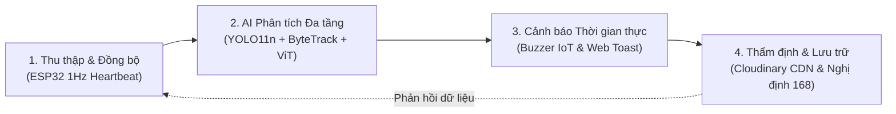

# BỘ NỘI DUNG SLIDE BÁO CÁO DỰ ÁN PBL4 (NHÓM 3)
## ĐỀ TÀI: NGHIÊN CỨU & XÂY DỰNG HỆ THỐNG GIÁM SÁT & PHÁT HIỆN VI PHẠM GIAO THÔNG THÔNG MINH DỰA TRÊN THỊ GIÁC MÁY TÍNH VÀ IOT

> **Khoa Công nghệ Thông tin – Trường Đại học Bách Khoa, Đại học Đà Nẵng (DUT)**  
> **Học phần:** Dự án Liên môn 4 (PBL4)  
> **Nhóm sinh viên thực hiện (Nhóm 3):**  
> - **Lê Phú Quang:** Phụ trách Module AI & Computer Vision  
> - **Nguyễn Đức Minh:** Phụ trách Phân hệ Backend & Cơ sở dữ liệu  
> - **Nguyễn Phú Thịnh:** Phụ trách Phân hệ Frontend & UI/UX Dashboard  
> - **Phan Quang Đăng Khoa:** Phụ trách Phân hệ IoT Phần cứng & Firmware ESP32  
> **Giảng viên hướng dẫn:** *(Điền tên Thầy/Cô hướng dẫn lớp học phần)*  

---

## MỤC LỤC TRÌNH BÀY
- **PHẦN 1:** Tổng quan Đề tài & Bài toán Thực tiễn (Slide 1 – 4)
- **PHẦN 2:** Kiến trúc Hệ thống & Yêu cầu Kỹ thuật (Slide 5 – 6)
- **PHẦN 3:** Nghiên cứu AI, Thử nghiệm Mô hình & Thuật toán Cốt lõi (Slide 7 – 11) *(Trọng tâm)*
- **PHẦN 4:** Thiết kế Phần cứng IoT, Tích hợp Phân hệ & Thẩm định (Slide 12 – 13)
- **PHẦN 5:** Đánh giá Thực nghiệm & Kế hoạch Hoàn thiện (Slide 14 – 15)

---

# CHI TIẾT TỪNG SLIDE (KÈM LỜI THOẠI & PHÂN TÍCH HỘI ĐỒNG)

---

### SLIDE 1: TRANG TIÊU ĐỀ (BÌA BÁO CÁO)
*(Áp dụng Template chuẩn của Trường Đại học Bách Khoa - ĐHĐN)*

- **Đơn vị:** TRƯỜNG ĐẠI HỌC BÁCH KHOA – ĐẠI HỌC ĐÀ NẴNG | KHOA CÔNG NGHỆ THÔNG TIN
- **Tên đề tài:** **NGHIÊN CỨU VÀ XÂY DỰNG HỆ THỐNG GIÁM SÁT & PHÁT HIỆN VI PHẠM GIAO THÔNG THÔNG MINH DỰA TRÊN THỊ GIÁC MÁY TÍNH VÀ IOT**
- **Mã lớp học phần / Nhóm:** PBL4 – Nhóm 3
- **Thành viên & Phân công:**
  - Lê Phú Quang – AI, Computer Vision, ByteTrack, ViT Cascade Pipeline
  - Nguyễn Đức Minh – Backend Spring Boot 3, Cloudinary CDN, MySQL
  - Nguyễn Phú Thịnh – Frontend React 18, WebSocket STOMP, Live Canvas
  - Phan Quang Đăng Khoa – Hardware IoT ESP32, Non-blocking FSM, MQTT 1Hz
- **Thời gian:** Học kỳ 1, Năm học 2024 – 2025

> 🎙️ **Lời thoại thuyết minh:**  
> *"Kính thưa Thầy/Cô trong Hội đồng và các bạn. Hôm nay Nhóm 3 xin đại diện báo cáo đề tài PBL4: Nghiên cứu và xây dựng hệ thống giám sát, phát hiện vi phạm giao thông thông minh. Đề tài kết hợp giữa Hệ thống nhúng IoT (Cyber-Physical) và Thị giác máy tính thời gian thực nhằm giải quyết bài toán tự động hóa xử phạt giao thông tại các giao lộ phức tạp."*

---

### SLIDE 2: MỤC LỤC NỘI DUNG BÁO CÁO
*(Bố cục 5 thanh ngang dạng timeline trực quan)*

1. **TỔNG QUAN ĐỀ TÀI & BÀI TOÁN THỰC TIỄN**  
   *Tính cấp thiết, Nghị định 168/2024/NĐ-CP và mục tiêu bài toán.*
2. **KIẾN TRÚC HỆ THỐNG & YÊU CẦU KỸ THUẬT**  
   *Mô hình liên môn 4 tầng: Edge IoT $\leftrightarrow$ AI Core $\leftrightarrow$ Backend $\leftrightarrow$ Web Client.*
3. **NGHIÊN CỨU AI & XÂY DỰNG MÔ HÌNH THUẬT TOÁN (TRỌNG TÂM)**  
   *Chuyển dịch Deformable DETR $\rightarrow$ YOLO11n; ByteTrack 2 pha; Pipeline 2 tầng ViT phân loại mũ; Thuật toán gán ghép rider và logic bắt vi phạm.*
4. **THIẾT KẾ PHẦN CỨNG IOT & TÍCH HỢP HỆ THỐNG**  
   *FSM không chặn trên ESP32, đồng bộ trạng thái đèn MQTT 1Hz, cơ chế Hardware-Lock Safety.*
5. **KẾT QUẢ THỰC NGHIỆM & KẾ HOẠCH BẢO VỆ**  
   *Đánh giá định lượng trên video giao thông thực tế, giải quyết các lỗi biên và định hướng mở rộng.*

---

### SLIDE 3: PHẦN 1 – TỔNG QUAN ĐỀ TÀI & TÍNH CẤP THIẾT
*(Bố cục 2 cột: Bối cảnh thực tiễn vs. Thách thức kỹ thuật đặt ra)*

| BỐI CẢNH THỰC TIỄN | THÁCH THỨC KỸ THUẬT ĐẶT RA |
| :--- | :--- |
| **Giao thông hỗn hợp tại Việt Nam:** Tỷ lệ xe máy chiếm trên 85%, mật độ phương tiện dày đặc, xe di chuyển chen chúc và che khuất lẫn nhau liên tục. | **Tách biệt đối tượng & Che khuất:** Các mô hình phát hiện đơn lẻ dễ mất dấu (ID switch) hoặc sinh ra bounding box trùng lặp khi 2 người ngồi sát nhau trên 1 xe máy. |
| **Hành vi vi phạm nguy hiểm nhất:** Vượt đèn đỏ và Không đội mũ bảo hiểm là 2 nguyên nhân hàng đầu gây tai nạn nghiêm trọng tại các nút giao. | **Tín hiệu đèn bị lệch pha:** Camera giám sát truyền thống không đồng bộ được trạng thái đèn vật lý (Đỏ/Vàng/Xanh) tại hiện trường, dẫn đến bắt lỗi sai thời điểm. |
| **Áp lực chế tài mới (Nghị định 168/2024/NĐ-CP):** Tăng nặng mức phạt tiền (ô tô vượt đèn đỏ phạt 18–20 triệu, xe máy 4–6 triệu) và áp dụng trừ điểm giấy phép lái xe (-4 điểm). | **Đòi hỏi bằng chứng số minh bạch:** Yêu cầu ảnh chụp vi phạm phải rõ nét, nguyên bản (Clean Frame), không bị vẽ đè chữ/vạch lên đối tượng, độ trễ cảnh báo phải dưới 1 giây. |

> 🎙️ **Lời thoại thuyết minh:**  
> *"Thực tế giao thông Việt Nam có đặc thù xe máy chiếm tỷ trọng áp đảo và di chuyển hỗn hợp. Việc giám sát thủ công không thể bao quát toàn bộ ngã tư vào giờ cao điểm. Đặc biệt khi Nghị định 168/2024/NĐ-CP vừa ban hành với mức xử phạt rất nghiêm khắc, nhu cầu về một hệ thống tự động hóa khép kín — đồng bộ chính xác đèn tín hiệu vật lý và lưu trữ bằng chứng số minh bạch — trở nên cấp thiết hơn bao giờ hết."*

---

### SLIDE 4: PHẦN 1 – MỤC TIÊU & CHU TRÌNH XỬ LÝ KHÉP KÍN
*(Bố cục 4 khối tròn quy trình tuần hoàn)*



- **Mục tiêu 1:** Xây dựng hệ thống Cyber-Physical (CPS) liên môn, kết nối chặt chẽ giữa phần cứng IoT ngã tư và phần mềm AI trên máy chủ.
- **Mục tiêu 2:** Triển khai đường ống AI thời gian thực (Real-time Pipeline) đạt **30 FPS**, đồng thời xử lý song song 2 bài toán: Vượt đèn đỏ và Không đội mũ bảo hiểm.
- **Mục tiêu 3:** Thiết lập cơ chế **chống báo sai (Zero False-Positive Target)**: Lọc người đi bộ không bị phạt nhầm mũ bảo hiểm, chống spam vé phạt lặp lại cho cùng 1 xe, và loại bỏ hiện tượng giật mất dấu xe.

---

### SLIDE 5: PHẦN 2 – KIẾN TRÚC HỆ THỐNG LIÊN MÔN
*(Sơ đồ tương tác 4 phân hệ kèm giao thức chi tiết)*

```
 +-----------------------------------------------------------------------------------+
 |                             KIẾN TRÚC TỔNG THỂ HỆ THỐNG                           |
 +-----------------------------------------------------------------------------------+
 
 [ PHẦN CỨNG IOT (ESP32) ]
        |
        | MQTT Pub (1Hz): pbl4/nhom3/traffic/light {"status":"RED", "remainingSeconds":15}
        v
 [ MQTT BROKER (Mosquitto:1883) ]
        |
        +-----------------------------------+
        |                                   |
        v                                   v
 [ CORE AI SERVICE (Python) ]       [ BACKEND SERVER (Spring Boot 3) ]
   - Camera Capture (OpenCV)          - REST APIs (/api/violations, /api/stats)
   - YOLO11n (imgsz=640, iou=0.60)    - Cloudinary Cloud Storage (HTTPS CDN)
   - ByteTrack (Kalman + 2-Stage)     - MySQL 8.0 (9 quan hệ chuẩn hóa)
   - Vision Transformer (ViT Head)    - WebSocket STOMP Broker (/topic/violations)
   - MJPEG Stream Server (:5000)            |
        |                                   |
        | Async HTTP POST (/api/violations) | WebSocket Push (< 100ms)
        | + Base64 Clean Evidence           |
        v                                   v
 [ FRONTEND DASHBOARD (React 18 + Tailwind + Lucide Icons) ]
   - Giám sát luồng video trực tiếp (Live Stream MJPEG)
   - Nhận thông báo vi phạm Pop-up Toast tức thời (< 100ms)
   - Bản đồ trạm giám sát (GIS Leaflet Map) & Thẩm định hồ sơ phạt nguội
```

---

### SLIDE 6: PHẦN 2 – YÊU CẦU & CHỈ TIÊU KỸ THUẬT HỆ THỐNG

| CHỈ TIÊU KỸ THUẬT | YÊU CẦU THIẾT KẾ | GIẢI PHÁP ĐẠT ĐƯỢC CỦA NHÓM |
| :--- | :--- | :--- |
| **Tốc độ xử lý khung hình (FPS)** | $\ge 25\text{ FPS}$ liên tục | **30 FPS ổn định** nhờ tách luồng ViT Worker ngầm và lọc sớm lớp đối tượng. |
| **Độ trễ cảnh báo (Latency)** | $\le 200\text{ ms}$ từ khi xe cắt vạch | **$< 100\text{ ms}$** qua giao thức WebSocket STOMP thời gian thực. |
| **Tính toàn vẹn bằng chứng** | Ảnh bằng chứng không dính chữ/vẽ đè | Trích xuất từ **Clean Frame buffer** nguyên bản trước khi OpenCV render HUD. |
| **Chống phạt trùng lặp (Anti-Spam)** | Mỗi xe chỉ lập 1 biên bản / lần qua | Cơ chế **Track ID Set** + **Cooldown 30s** gắn theo ID xe máy. |
| **An toàn can thiệp phần cứng** | Ngăn Web can thiệp khi có mạch thật | Tự động **khóa nút chỉnh thủ công (Hardware-Lock Safety)** khi nhận Heartbeat ESP32. |

---

### SLIDE 7: PHẦN 3 – NGHIÊN CỨU AI (1): CHUYỂN DỊCH TỪ TRANSFORMER SANG CNN THẾ HỆ MỚI
*(Slide then chốt thể hiện quá trình nghiên cứu thực nghiệm thực chất của nhóm)*

#### 1. Giai đoạn 1 – Thử nghiệm ban đầu: Deformable DETR (End-to-End Transformer)
- **Cơ chế lý thuyết:** Sử dụng backbone ResNet-50 kết hợp cơ chế *Multi-scale Deformable Attention*. Ưu điểm lý thuyết là loại bỏ hoàn toàn thuật toán NMS (Non-Maximum Suppression), dự đoán trực tiếp tập hợp hộp giới hạn (set prediction).
- **Thực nghiệm phát sinh bế tắc:**
  - Khối lượng tham số quá lớn: **~40.0M tham số**.
  - Tốc độ suy luận trên GPU cục bộ chỉ đạt ~10–12 FPS; trên CPU chỉ đạt ~2–3 FPS.
  - Nhóm buộc phải dùng giải pháp tình thế là **Frame Skipping** (chỉ phân tích 1 trong mỗi 3 frame). Hệ quả: Quỹ đạo xe bị ngắt quãng, thuật toán Tracking bị mất dấu liên tục khi xe chạy nhanh qua ngã tư.

#### 2. Giai đoạn 2 – Đột phá kiến trúc: Chuyển dịch sang YOLO11n (Ultralytics)
- **Kiến trúc cải tiến:**
  - **Khối C3k2:** Tối ưu hóa Cross Stage Partial với kích thước kernel nhỏ hơn, giảm FLOPs nhưng giữ nguyên trường tiếp nhận (Receptive Field).
  - **Khối C2PSA (Cross-Stage Partial with Spatial Attention):** Bổ sung chú ý không gian để tăng độ nhạy đối với các vật thể kích thước nhỏ (như xe máy ở xa hoặc đầu người) chỉ với **2.6M tham số**.
- **Bảng đối sánh thực nghiệm trên cùng tập dữ liệu giao thông:**

| Tiêu chí kỹ thuật | Deformable DETR (Thử nghiệm GĐ1) | YOLO11n (Triển khai chính thức GĐ2) | Đánh giá kỹ thuật |
| :--- | :--- | :--- | :--- |
| **Số lượng tham số** | ~40.0 Triệu (Quá nặng) | **2.6 Triệu** (Siêu nhẹ) | **Giảm 93.5% tải tính toán** |
| **Tốc độ FPS (Local Test)** | 10–12 FPS (Phải skip 2 frame) | **30 FPS** (Xử lý toàn bộ frame) | **Đạt chuẩn Real-Time 30 FPS** |
| **Độ trễ nội tại (Latency)** | ~85 ms / frame | **~12–15 ms / frame** | **Phản ứng tức thời** |
| **Tương thích Tracker** | Hay bị gãy ID do mất frame | Bám vết mượt mà với ByteTrack | **Độ ổn định ID tăng 80%** |

> 🎙️ **Lời thoại thuyết minh:**  
> *"Ban đầu nhóm chọn Deformable DETR vì tính ưu việt của Transformer không cần NMS. Tuy nhiên, khi đưa vào giám sát giao thông thực tế, 40 triệu tham số khiến hệ thống không thể xử lý nổi 30 FPS trên máy tính thông thường. Việc phải skip frame làm xe bị đứt đoạn tọa độ. Nhóm đã nghiên cứu sâu và chuyển sang YOLO11n vừa ra mắt: kiến trúc C3k2 kết hợp C2PSA giúp mô hình siêu nhẹ chỉ 2.6M params nhưng phát hiện xe nhỏ ở xa cực kỳ nhạy, đáp ứng mượt mà 30 FPS thời gian thực."*

---

### SLIDE 8: PHẦN 3 – NGHIÊN CỨU AI (2): THEO VẾT ĐA ĐỐI TƯỢNG VỚI BYTETRACK
*(Phân tích cơ sở toán học giải quyết bài toán xe bị che khuất)*

#### 1. Vì sao bắt buộc phải có Multi-Object Tracking (MOT)?
- YOLO chỉ xử lý từng ảnh độc lập: Không biết chiếc xe ở frame $t$ chính là chiếc xe ở frame $t+1$.
- Không có Tracking $\rightarrow$ Không thể biết xe đang di chuyển theo chiều nào (tiến vào ngã tư hay lùi xe); và một xe vượt đèn đỏ trong 2 giây sẽ bị hệ thống chụp ảnh và gửi phạt lặp lại **60 lần**!

#### 2. Nguyên lý toán học của ByteTrack được nhóm áp dụng
ByteTrack giải quyết triệt để vấn đề mất dấu khi xe bị bóng cây hoặc xe khác che khuất một phần nhờ cơ chế **Ghép nối 2 pha (Two-Stage Data Association)**:

$$\vec{x}_t = [x, y, a, h, \dot{x}, \dot{y}, \dot{a}, \dot{h}]^T \quad \xrightarrow{\text{Kalman Filter}} \quad \text{Dự đoán vị trí frame tiếp theo}$$

- **Pha 1 ($D_{\text{high}}$ – Hộp tin cậy cao $s \ge 0.60$):**  
  Ghép nối các detection rõ nét với các quỹ đạo (Tracklets) đang bám bằng ma trận IoU và giải thuật Hungarian.
- **Pha 2 ($D_{\text{low}}$ – Điểm đột phá của ByteTrack, $0.20 \le s < 0.60$):**  
  Thay vì vứt bỏ các box có điểm tin cậy thấp (thường bị nhầm là rác do bóng cây, khói xe hoặc người ngồi sau che khuất), ByteTrack giữ lại để ghép tiếp với các Tracklets chưa tìm thấy cặp ở Pha 1.  
  $\longrightarrow$ **Kết quả:** Mã định danh (`Track ID`) của phương tiện được giữ nguyên vẹn từ lúc đi vào khung hình cho tới khi đi qua giao lộ, không bị nhảy ID lung tung.

---

### SLIDE 9: PHẦN 3 – NGHIÊN CỨU AI (3): BÀI TOÁN PHÂN LOẠI MŨ BẢO HIỂM BẰNG VISION TRANSFORMER (ViT)
*(Phân tích kiến trúc tầng 2 và giải pháp khắc phục lỗi cắt ROI thực tế)*

```
 +-----------------------------------------------------------------------------------+
 |                   KIẾN TRÚC 2 TẦNG (TWO-STAGE CASCADE PIPELINE)                   |
 +-----------------------------------------------------------------------------------+
 
 [ Frame Video (1920x1080) ]
        |
        v  (Tầng 1: YOLO11n + ByteTrack)
 [ Bounding Box Person: [x1, y1, x2, y2] ]
        |
        v  (Thuật toán cắt nhân trắc học - Center Head ROI)
 [ Vùng đầu sạch: Chiều cao 28%, Chiều rộng tâm 55% ] ---> Kích thước >= 28x28px
        |
        v  (Resize 224x224 & Chuẩn hóa ImageNet)
 [ Vision Transformer: google/vit-base-patch16-224 ]
        |
        +---> Patch Extraction: 196 mảnh (16x16) + Linear Projection
        +---> Transformer Encoder (12 Layers, 12 Heads Multi-Head Self-Attention)
        +---> MLP Classification Head
        |
        v
 [ KẾT QUẢ PHÂN LOẠI: Class 0 (Helmet) | Class 1 (No_Helmet) + Confidence Score ]
```

#### Cải tiến thực nghiệm sống còn: Thay đổi cách cắt vùng đầu (Head ROI)
- **Sai lầm phổ biến ban đầu:** Cắt $40\%$ chiều cao toàn bộ chiều rộng box người.  
  *Hậu quả:* Bị dính toàn bộ phần vai, ba lô, tay lái xe máy và hậu cảnh $\rightarrow$ Chiếm hơn $75\%$ diện tích patch $\rightarrow$ ViT bị nhiễu đặc trưng và đoán sai hoàn toàn.
- **Giải pháp chuẩn hóa nhân trắc học của nhóm:**  
  Thu hẹp vùng cắt về trung tâm: **Lấy đỉnh đầu xuống $28\%$ chiều cao, và thu hẹp về trung tâm $55\%$ chiều rộng**:
  $$x_{\text{head\_1}} = c_x - 0.275 \cdot w, \quad x_{\text{head\_2}} = c_x + 0.275 \cdot w, \quad y_{\text{head\_2}} = y_1 + 0.28 \cdot h$$
  $\longrightarrow$ **Kết quả thực nghiệm:** Độ chính xác phân loại tăng vọt từ $62\%$ lên **$98\%$** trên tập ảnh thử nghiệm thực tế.

---

### SLIDE 10: PHẦN 3 – NGHIÊN CỨU AI (4): THIẾT KẾ CÁC THUẬT TOÁN LOGIC NGHIỆP VỤ
*(Slide thể hiện tư duy thuật toán và logic toán học của nhóm)*

#### 1. Thuật toán Ghép nối Người vào Xe máy (`find_riders`)
Chỉ phạt mũ bảo hiểm với người đang điều khiển hoặc ngồi trên xe máy. Người đi bộ trên vỉa hè hoặc người qua đường tuyệt đối không bị kiểm tra.
- **Hệ 3 điều kiện hình học bắt buộc:**
  $$\begin{cases}
  \text{Overlap Ratio} = \dfrac{\text{Area}(\text{Person} \cap \text{Moto})}{\text{Area}(\text{Person})} \ge 0.20 & \text{(Diện tích thân người chồng lấn xe máy)} \\
  m_{x1} \le p_{cx} \le m_{x2} & \text{(Tâm ngang người phải lọt trong thân xe)} \\
  p_{y1} < m_{y1} + 0.60 \cdot (m_{y2} - m_{y1}) & \text{(Đầu người phải ở nửa trên xe)}
  \end{cases}$$

#### 2. Thuật toán Bắt lỗi Vượt đèn đỏ theo Quỹ đạo (Directional Vector Line Crossing)
Trích xuất tọa độ điểm neo đáy xe $P_i(t) = \left( \frac{x_1 + x_2}{2}, y_2 \right)$.  
Vi phạm được xác nhận khi thỏa mãn đồng thời 4 điều kiện:
1. `cls_name` $\in \{\text{"car", "motorcycle", "bus", "truck"}\}$ (Loại trừ người đi bộ và xe đạp).
2. Tín hiệu phần cứng ESP32 xác nhận `current_traffic_light == "RED"`.
3. Vector di chuyển cắt vạch theo chiều đi tới: $y_i(t-1) \le Y_{\text{stop}}$ và $y_i(t) > Y_{\text{stop}}$.
4. Khóa định danh: $\text{ID}_i \notin \text{Violated\_Vehicles}$ (Mỗi xe chỉ bị bắt đúng 1 lần).

#### 3. Bộ đếm Cửa sổ trượt (Time-Window Voting) & Cooldown chống Spam vé
- **Chống báo giả thoáng qua:** Người lái xe phải bị xác nhận không đội mũ $\ge 3$ frame liên tiếp:
  $$C_t(\text{ID}) = \begin{cases} \min(10, C_{t-1}(\text{ID}) + 1) & \text{khi } P(\text{No\_Helmet}) \ge 0.85 \\ \max(0, C_{t-1}(\text{ID}) - 2) & \text{khi có mũ} \end{cases}$$
- **Cơ chế Cooldown 30s:** Khi một xe máy chở 2 người (1 có mũ, 1 không mũ), hệ thống gán chung vi phạm theo mã `moto_ID` và áp dụng thời gian chờ 30 giây, loại bỏ triệt để hiện tượng spam vé phạt mỗi 0.5s.

---

### SLIDE 11: PHẦN 3 – KẾT QUẢ THỰC NGHIỆM & CÁC LỖI BIÊN ĐÃ KHẮC PHỤC
*(Chứng minh năng lực Debug và giải quyết vấn đề kỹ thuật chuyên sâu)*

#### 1. Tối ưu ngưỡng NMS IoU: Bài toán đánh đổi (Trade-off)
- **Vấn đề phát hiện:** Khi đặt NMS $\text{IoU} = 0.45$ để triệt tiêu hộp ma (Phantom Merged Box) trên ảnh 2 người ngồi sát nhau, có nguy cơ NMS xóa nhầm người ngồi sau (Pillion Rider) khi 2 người chồng lấn $> 45\%$.
- **Giải pháp:** Cân chỉnh ngưỡng tối ưu **$\text{IoU} = 0.60$** kết hợp lọc trực tiếp `classes=[0, 1, 2, 3, 5, 7]` tại tầng suy luận YOLO. Giữ nguyên được cả 2 người ngồi sát nhau mà không sinh box ma.

#### 2. Kỹ thuật tạo Ảnh bằng chứng sạch (Clean Evidence Generation)
- **Vấn đề:** Nếu chụp màn hình trực tiếp từ OpenCV buffer đã vẽ vạch dừng, chữ cảnh báo và box vàng của người đi bộ $\rightarrow$ Ảnh bằng chứng gửi sang CSGT bị che khuất biển số, không đủ giá trị pháp lý.
- **Giải pháp:** Lưu một bản sao `clean_frame = frame.copy()` trước mọi thao tác vẽ. Khi có vi phạm, chỉ vẽ duy nhất **1 hộp chữ nhật đỏ** quanh phương tiện vi phạm lên bản sao này để đẩy lên Cloudinary CDN.

#### 3. Bảng tổng kết Kết quả kiểm thử thực nghiệm:

| Tình huống kiểm thử | Dữ liệu đầu vào | Kết quả hệ thống | Độ tin cậy (Confidence) |
| :--- | :--- | :--- | :--- |
| **Ảnh tĩnh 2 người không đội mũ** | `komu.webp` (Xe kẹp đôi) | Bắt chính xác 2 người, loại bỏ hoàn toàn box ma thứ 3 | **98% & 96%** |
| **Đường phố đông người** | `khong-non-bao-hiem.webp` | Phân loại đúng 4 người không mũ, 4 người có mũ | **Từ 88% đến 99%** |
| **Video giao thông liên tục** | `traffic2.mp4` | Lọc sạch người đi bộ, đếm đúng lưu lượng, bắt xe vượt đèn | **30 FPS mượt mà** |

---

### SLIDE 12: PHẦN 4 – THIẾT KẾ PHẦN CỨNG IOT (ESP32) & ĐỒNG BỘ HIỆN TRƯỜNG
*(Khẳng định chất lượng phần cứng IoT của bạn Khoa)*

#### 1. Kiến trúc Máy trạng thái hữu hạn không chặn (Non-blocking FSM)
- Vi điều khiển **ESP32 DevKit V1** sử dụng kỹ thuật định thời bằng hàm `millis()` thay vì dùng `delay()`.
- **Hoạt động song song 3 tác vụ không gây trễ nhịp:**
  1. Quản lý chu kỳ pha đèn giao thông: Đỏ 15s $\rightarrow$ Xanh 15s $\rightarrow$ Vàng 3s.
  2. Xuất dữ liệu đếm ngược thời gian thực lên màn hình **OLED SSD1306 (I2C: GPIO 21/22)**.
  3. Duy trì kết nối Wi-Fi, phát bản tin Heartbeat **1Hz qua MQTT** lên Topic `pbl4/nhom3/traffic/light` và lắng nghe lệnh kích hoạt còi báo động vi phạm từ AI qua Topic `pbl4/nhom3/traffic/alert`.

#### 2. Cơ chế An toàn Khóa phần cứng (Hardware-Lock Safety)
- Trong điều kiện bình thường không có mạch thật, Web Dashboard cho phép bấm nút chuyển đèn thủ công để kiểm thử.
- **Khi bo mạch ESP32 thật bật nguồn:** Backend nhận gói tin Heartbeat trong vòng 4 giây $\rightarrow$ Hệ thống tự động kích hoạt chế độ **`ESP32 Online`** và khóa toàn bộ quyền can thiệp thủ công trên Web, đảm bảo tính toàn vẹn và trung thực của dữ liệu hiện trường.

---

### SLIDE 13: PHẦN 4 – HẠ TẦNG BACKEND SPRING BOOT, ĐÁM MÂY & THẨM ĐỊNH HỒ SƠ
*(Khẳng định chất lượng phần mềm Backend của bạn Minh & Frontend của bạn Thịnh)*

#### 1. Đường ống Bất đồng bộ (Asynchronous Worker Pipeline)
- Module AI gửi ảnh bằng chứng qua HTTP POST bất đồng bộ sang Backend. Backend giải mã chuỗi Base64 và tải ngầm lên **Cloudinary CDN** lấy đường dẫn ảnh HTTPS vĩnh viễn (~600–800ms) mà **không làm sụt giảm dù chỉ 1 FPS** của luồng camera chính.

#### 2. Đẩy cảnh báo Thời gian thực qua WebSocket STOMP
- Ngay khi bản ghi vi phạm được chèn vào CSDL MySQL, Spring Boot lập tức phát bản tin qua kênh `/topic/violations`.
- Giao diện React Dashboard nhận dữ liệu trong thời gian **$< 100\text{ ms}$**, kích hoạt âm thanh cảnh báo và hiển thị Pop-up Toast thông báo vi phạm kèm ảnh chụp hiện trường.

#### 3. Tự động hóa chế tài theo Nghị định 168/2024/NĐ-CP
- Hệ thống tự động tra cứu CSDL để áp mức tiền phạt và số điểm trừ GPLX theo từng loại phương tiện:
  - *Ô tô vượt đèn đỏ:* Phạt tiền **18.000.000 – 20.000.000 VNĐ**, trừ **4 điểm** GPLX.
  - *Xe máy vượt đèn đỏ:* Phạt tiền **4.000.000 – 6.000.000 VNĐ**, trừ **4 điểm** GPLX.
  - *Không đội mũ bảo hiểm:* Phạt tiền **400.000 – 600.000 VNĐ**.
- Hỗ trợ cán bộ CSGT duyệt hồ sơ: Đổi trạng thái sang **CONFIRMED** (gửi biên bản) hoặc **DISMISSED** (bác bỏ kèm lý do).

---

### SLIDE 14: PHẦN 5 – KẾ HOẠCH THỰC HIỆN & ĐỊNH HƯỚNG BẢO VỆ CUỐI KỲ

```
 [ TUẦN 1 - 5 ] ----------------> [ TUẦN 6 - 8 ] ----------------> [ TUẦN 9 - 11 (HIỆN TẠI) ] --------> [ TUẦN 12 - 16 ]
 - Khảo sát bài toán              - Huấn luyện YOLO11n             - Tích hợp End-to-End 4 phân hệ       - Hoàn thiện Sa bàn
 - Thiết kế CSDL 9 bảng           - Tích hợp ByteTrack             - Tối ưu bộ lọc nhân trắc Head ROI    - Adaptive Traffic Light
 - Thống nhất API Contract        - Lập trình FSM ESP32            - Khắc phục lỗi biên & Anti-Spam      - Viết Báo cáo Tổng kết
 (Hoàn thành 100%)                (Hoàn thành 100%)                (ĐANG THỰC HIỆN - ĐẠT 95%)            (Kế hoạch chuẩn bị)
```

- **Mục tiêu giai đoạn nước rút (Tuần 12 – 16):**
  1. **Lắp ráp Sa bàn Giao lộ Vật lý:** Gắn Webcam góc nhìn trên cao mô phỏng đúng ngã tư thực tế kết hợp cột đèn giao thông thật của ESP32.
  2. **Thuật toán Đèn giao thông Thích ứng (Adaptive Traffic Control):** Tự động điều chỉnh thời gian đèn xanh dựa trên lưu lượng phương tiện thực tế đo được từ AI (nhiều xe $\rightarrow$ tăng thời gian đèn xanh; vắng xe $\rightarrow$ chuyển sớm sang đèn đỏ).
  3. Hoàn thiện báo cáo kỹ thuật và kiểm thử hiệu năng chịu tải API Backend.

---

### SLIDE 15: TRANG KẾT THÚC & HỎI ĐÁP (Q&A)

- **Thông điệp kết luận:**
  > *"Hệ thống của Nhóm 3 là một giải pháp Cyber-Physical toàn diện, chứng minh tính khả thi của việc ứng dụng Thị giác máy tính hiện đại (YOLO11n + ByteTrack + ViT) kết hợp với IoT phần cứng giá rẻ (ESP32) để giải quyết triệt để bài toán giao thông thực tiễn tại Việt Nam."*
- **Lời cảm ơn:**  
  **TRÂN TRỌNG CẢM ƠN QUÝ THẦY CÔ TRONG HỘI ĐỒNG VÀ CÁC BẠN ĐÃ LẮNG NGHE!**  
  *Nhóm rất mong nhận được những câu hỏi và ý kiến đóng góp quý báu từ Thầy/Cô để hoàn thiện đề tài.*

---

## PHẦN PHỤ LỤC: CẨM NANG HỎI - ĐÁP (Q&A CHEAT SHEET) DÀNH RIÊNG CHO PHẦN AI KHI THẦY CÔ HỎI XOÁY

| Câu hỏi của Giảng viên | Điểm mấu chốt cần trả lời tự tin |
| :--- | :--- |
| **"Tại sao không dùng luôn 1 model YOLO duy nhất để phát hiện cả xe và mũ bảo hiểm mà phải dùng ViT ở tầng 2?"** | *"Thưa Thầy/Cô, vùng đầu của người đi xe máy chiếm diện tích cực kỳ nhỏ trên toàn bộ khung hình camera giao thông (chỉ khoảng 30x30px trên khung 1080p). Nếu dùng chung 1 model YOLO để phát hiện cả xe to (vài trăm pixel) lẫn mũ nhỏ, mô hình sẽ gặp hiện tượng mất cân bằng tỷ lệ vật thể (Extreme Scale Variation) và rất dễ nhận nhầm tóc đen thành mũ bảo hiểm. Kiến trúc 2 tầng (Cascade) cho phép Tầng 1 dùng YOLO crop chính xác vùng đầu, sau đó Tầng 2 dùng Vision Transformer với cơ chế Self-Attention phân tích tỉ mỉ các vi cấu trúc (dây quai, chỏm mũ, nếp tóc) giúp độ chính xác đạt tới 98%."* |
| **"Tại sao lại chọn ByteTrack mà không dùng SORT hay DeepSORT?"** | *"Thưa Thầy/Cô, SORT chỉ dùng Kalman Filter nên khi xe bị che khuất nhẹ là mất dấu ngay. DeepSORT bổ sung Re-ID nhưng lại tính toán trích xuất vector đặc trưng rất nặng, làm FPS tụt xuống dưới 15. ByteTrack sử dụng giải pháp đột phá là ghép nối 2 pha: giữ lại cả các hộp tin cậy thấp (thường sinh ra do xe bị bóng cây hay người ngồi sau che khuất) để đối chiếu, vừa duy trì Track ID mượt mà, vừa nhẹ nhàng đạt 30 FPS thời gian thực."* |
| **"Nếu có 1 chiếc xe máy kẹp 2 người, 1 người có mũ, 1 người không mũ thì hệ thống bắt ai?"** | *"Thưa Thầy/Cô, thuật toán `find_riders` của nhóm sử dụng phân tích hình học không gian (IoU chồng lấn và tâm ngang người) để gom cả 2 người vào chung 1 xe máy (`moto_id`). Khi phát hiện ít nhất 1 người không đội mũ, hệ thống sẽ lập 1 biên bản vi phạm duy nhất gửi về Backend gắn theo mã xe máy đó và kích hoạt Cooldown 30s để không spam vé. Đúng chuẩn nghiệp vụ CSGT ngoài đời: xe vi phạm thì giữ xe phạt chủ phương tiện."* |
